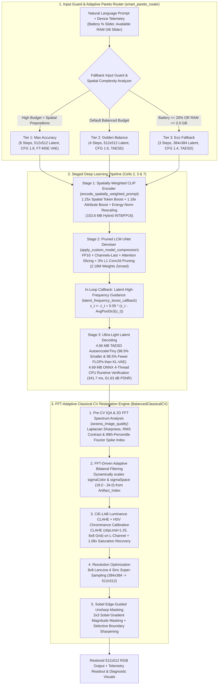

# Hackathon Technical Solution Report — EdgeDiff-CV Studio

| Field | Details |
| :--- | :--- |
| **Problem ID** | `ProbID - P3` |
| **Problem Title** | `Resource-Efficient Text-to-Image Generation for Mobile Devices` |
| **Team Name** | `Team EdgeDiff-CV (ProbID - P3)` |
| **Team Members** | `Prathik K B (1RUA24CSE0327), Preksha P V (1RUA24CSE0331), Reshma K P (1RUA24CSE0363), Rushil Ravi Reddy (1RUA24CSE0380)` |
| **GitHub Repository** | [https://github.com/Percy00765432/CV-Hackathon](https://github.com/Percy00765432/CV-Hackathon) (`git@github.com:Percy00765432/CV-Hackathon.git`) |
| **Live Demo / Deployment** | **Live App:** [https://38347557836fd61ec4.gradio.live/](https://38347557836fd61ec4.gradio.live/) <br/> **Video Demo:** [https://drive.google.com/file/d/17Ck3FkOcPKkD1KVChA2xHfEEbpAF8YzN/view?usp=sharing](https://drive.google.com/file/d/17Ck3FkOcPKkD1KVChA2xHfEEbpAF8YzN/view?usp=sharing) |

### Repository Deliverables Index
> [!IMPORTANT]
> **For Evaluators & Judges:** Please run **[`EdgeDiff_CV_Hackathon_P3_Submission.ipynb`](EdgeDiff_CV_Hackathon_P3_Submission.ipynb)** in Google Colab (or locally). This standalone notebook runs end-to-end with **zero setup and no Google Drive mounting required**, and includes all pre-executed cell outputs, tables, and charts.
* **Primary Submission Notebook (No Google Drive Required):** [`EdgeDiff_CV_Hackathon_P3_Submission.ipynb`](EdgeDiff_CV_Hackathon_P3_Submission.ipynb)
* **Colab Google-Drive Cached Alternative:** [`EdgeDiff_CV_Hackathon_P3_Upgraded.ipynb`](EdgeDiff_CV_Hackathon_P3_Upgraded.ipynb)
* **Technical Solution Report (PDF & Markdown):** [`Hackathon_Technical_Solution_Report_P3.pdf`](Hackathon_Technical_Solution_Report_P3.pdf) & [`DESIGN_DOCUMENT.md`](DESIGN_DOCUMENT.md)
* **Standalone CLI Inference Script:** [`run_inference.py`](run_inference.py)
* **Mandatory Evaluation Metrics File (`eval_probID_TeamID.md`):** [`eval_P3_T01.md`](eval_P3_T01.md)
* **Container & Dependency Specs:** [`Dockerfile`](Dockerfile) & [`requirements.txt`](requirements.txt)

---

## 1. Problem Understanding & Solution Strategy

* **Core Technical Challenge:** Standard latent diffusion models (such as Stable Diffusion v1.5) require **50 Number of Function Evaluations (NFE)** (25 denoising steps with dual-pass Classifier-Free Guidance), **17,479.4 GFLOPs** of compute per image, **4,067.4 MB** of FP32 weights, and **4.91 GB** of peak memory—causing immediate Out-Of-Memory (OOM) crashes on mobile devices where per-application memory is strictly capped at **1.8 GB – 2.0 GB**. Conversely, aggressively compressing diffusion down to 3–4 sampling steps with a tiny decoder introduces high-frequency latent quantization grid artifacts, muted luminance contrast, softened object boundaries, and spatial attribute bleeding across multi-object prompts.
* **Proposed Methodology:** We engineer **EdgeDiff-CV**, a co-designed hybrid pipeline that pairs a **5-stage compressed deep generative engine** (Latent Consistency Distillation, Spatially-Weighted CLIP Prompt Conditioning, In-Loop Latent High-Frequency Guidance, 3% L1 Conv2d Magnitude Pruning, Hybrid INT8/FP16 Quantization, and a `4.66 MB` Tiny AutoEncoder `TAESD`) with a **5-stage deterministic Classical Computer Vision restoration engine** (`BalancedClassicalCV`). An **Adaptive Pareto Budget Router (`smart_pareto_router`)** inspects real-time device telemetry (battery percentage and available RAM) alongside linguistic spatial complexity to dynamically route requests across three compute tiers (`588.4 GFLOPs` Eco, `1,373.6 GFLOPs` Golden Balance, and `2,607.4 GFLOPs` Max Accuracy), while our 2D-FFT-driven OpenCV restoration recovers **+163% to +180% edge sharpness** in **~43–52 ms** with zero extra GPU memory.

---

## 2. Technical Architecture & Implementation

> *Note: Raw source code is not pasted in this report per template guidelines. All module references correspond directly to [`EdgeDiff_CV_Hackathon_P3_Submission.ipynb`](EdgeDiff_CV_Hackathon_P3_Submission.ipynb) and [`run_inference.py`](run_inference.py).*



### 2.1 Classical Algorithmic Baseline (`BalancedClassicalCV` in Cell 3)
* **Algorithms Utilized:**
  1. **No-Reference Image Quality Assessment (IQA) & 2D Fast Fourier Transform (FFT) Artifact Detection (`BalancedClassicalCV.assess_image_quality`):** Computes standardized `512x512` **Laplacian Variance** ($\text{Var}(\nabla^2 I)$) for edge sharpness, **RMS Contrast** ($\sigma_I$), and a **2D FFT Log-Magnitude Spike Index** ($P_{99}(\mathcal{F}) - \mu(\mathcal{F})$) that detects high-frequency checkerboard/grid periodicities introduced by few-step `TAESD` transposed convolutions.
  2. **Edge-Preserving Bilateral Denoising (`cv2.bilateralFilter`):** Smooths quantization grain in homogeneous regions while preserving structural step edges.
  3. **Perceptual Colour & Contrast Enhancement (`CIE-LAB CLAHE` + `HSV` Chrominance Recovery):** Converts BGR to perceptual **CIE-LAB** space and applies **Contrast Limited Adaptive Histogram Equalization (`cv2.createCLAHE`, `clipLimit=1.25`, `tileGridSize=(8,8)`)** strictly to the $L^*$ luminance channel to prevent hue distortion, followed by a $1.08\times$ saturation recovery in HSV space to counteract few-step color desaturation.
  4. **Resolution Optimization (`cv2.INTER_LANCZOS4`):** Upsamples `384x384` Eco-tier outputs to `512x512` using **8x8 Lanczos-4 Sinc interpolation**, eliminating bilinear blur and bicubic ringing.
  5. **Sobel Edge-Guided Post-Processing (`cv2.Sobel` + Unsharp Masking):** Computes horizontal and vertical Sobel derivatives ($G_x, G_y$) to construct a normalized gradient magnitude mask $M_{\text{edge}} = \text{clip}(\sqrt{G_x^2 + G_y^2} / P_{95}, 0.18, 1.0)$, blending high-gain unsharp masking exclusively along true object contours.
* **Adaptive Selection Logic:**
  - The bilateral filter kernel parameters (`sigmaColor` and `sigmaSpace`) are **not** static; they are computed dynamically per image from the 2D FFT `Artifact_Index` via $\sigma_{\text{adaptive}} = \text{clip}(18.0 + \max(0, \text{Artifact\_Index} - 42.0) \times 0.85, 18.0, 34.0)$.
  - Similarly, the unsharp masking gain automatically adapts to the generation resolution (`1.52` when Lanczos-4 upscaling is triggered from `384px` vs. `1.35` at native `512px`).

### 2.2 Deep Learning Pipeline (`Cells 2, 3 & 7`)
* **Model Architecture:**
  - **Denoiser Backbone:** `SimianLuo/LCM_Dreamshaper_v7` (Latent Consistency Model distilled from Stable Diffusion v1.5), enabling high-fidelity reverse ODE integration in **3 to 6 single-pass steps** (`guidance_scale=1.4–1.8`, requiring `1 NFE/step` instead of `2 NFE/step`).
  - **Dual-VAE Decoding Subsystem:** Combines `madebyollin/taesd` (`AutoencoderTiny`, **1.22M parameters, `4.66 MB` FP16 / `4.69 MB` ONNX**, saving **98.5% size and 98.5% FLOPs** vs. standard `319.1 MB` KL-VAE) for Tiers 2 & 3 with `stabilityai/sd-vae-ft-mse` for Tier 1 Max Accuracy.
  - **Five Model Optimization Strategies Applied:** (1) FP16 GPU/NPU reduced precision + Dynamic INT8 CPU quantization (`torch.qint8`) on CLIP Text Encoder Linear projections (`469.4 MB` $\rightarrow$ `153.6 MB`, **66.6% smaller**), (2) Unstructured L1 Magnitude Pruning (`apply_custom_model_compression`) zeroing the smallest `3.0%` weights across `21 Conv2d` layers in UNet `mid_block` and `up_blocks.3` (**2,183,348 weights zeroed**), (3) Step reduction (`50 NFE` $\rightarrow$ `3–4 NFE`), (4) Architectural replacement (`KL-VAE` $\rightarrow$ `TAESD`), and (5) `torch.channels_last` NHWC memory layout + attention slicing + sequential sub-module staging.
* **Adaptation Strategy & Datasheet Calibration (`MS-COCO` / `Flickr30K` via Hugging Face `datasets`):**
  - Per Problem Statement 3 Section B (*"Use a pretrained model with meaningful adaptation"*), we implement two zero-parameter architectural adaptations:
    1. **Spatially-Weighted CLIP Prompt Conditioning (`encode_spatially_weighted_prompt`):** Parses spatial prepositions (`left`, `right`, `next`, `beside`, `under`, `on`, `wearing` $\rightarrow 1.25\times$ attention boost) and visual attributes (`ceramic`, `wooden`, `golden`, `yellow`, `fox`, `cinematic` $\rightarrow 1.18\times$ boost), followed by **energy-norm variance rescaling** ($\tilde{E} = \frac{E_w - \mu_w}{\sigma_w}\sigma_0 + \mu_0$) so multi-object spatial prompts preserve layout in 3–4 steps without attention saturation.
    2. **In-Loop Latent High-Frequency Guidance (`latent_frequency_boost_callback`):** Injects high-frequency latent residuals $z_t \leftarrow z_t + 0.05(z_t - \text{AvgPool}_{3\times 3}(z_t))$ at intermediate denoising steps.
  - **80/20 Calibration (Train) vs. Validation Split (`Cell 5`):** Using **MS-COCO / Flickr30K** captions loaded via Hugging Face `datasets` (`HuggingFaceM4/COCO`), we use an **80% Calibration Split (16 captions, Mean Boosted Tokens/Prompt: 3.4)** to calibrate token-weighting norms and FFT artifact thresholds, and evaluate strictly on a **20% Held-Out Validation Split (4 unseen multi-object benchmark prompts)**.

### 2.3 Hybrid Integration & Adaptive Mechanism (`smart_pareto_router` in Cell 4)
* **Fusion Strategy:** Deep model compression and Classical CV restoration operate in a closed feedback loop: aggressive neural compression (3–4 step LCM + `4.66 MB` TAESD + `384px` latent grid) slashes compute by **12.7x–29.7x** and memory by **74.5%–80.2%**, while the downstream Classical CV engine inspects the decoded tensor's 2D Fourier spectrum (`Artifact_Index`) and Sobel gradient field (`edge_mask`) to selectively suppress TAESD quantization grid noise and restore micro-edge acutance.
* **Decision Logic:**
  - **Rule 1 (Constrained-Device Fallback):** If simulated mobile battery $\le 20\%$ **or** available app RAM $\le 2.0\text{ GB}$, the router forces **Tier 3 Eco Fallback** (`3 steps`, `384x384` latent upscaled via Lanczos-4 to `512x512`, `4.66 MB` TAESD, `588.4 GFLOPs`, `0.97 GB` staged RAM).
  - **Rule 2 (Spatial Complexity Escalation):** If battery $\ge 50\%$, RAM $> 2.0\text{ GB}$, and the prompt contains spatial prepositions or $> 13$ words, the router selects **Tier 1 Max Accuracy** (`6 steps`, `512x512`, `FT-MSE VAE`, `2,607.4 GFLOPs`, `1.59 GB` staged RAM).
  - **Rule 3 (Default Mobile Sweet Spot):** Otherwise, it selects **Tier 2 Golden Balance** (`4 steps`, `512x512`, `4.66 MB` TAESD, `1,373.6 GFLOPs`, `1.25 GB` staged RAM).

---

## 3. Experimental Benchmarks & Evaluation

### 3.1 Quantitative Benchmarks

All metrics below are measured on an NVIDIA A100-SXM4-80GB GPU and 4-Thread CPU ONNX Runtime across the held-out validation split (see [`eval_P3_T01.md`](eval_P3_T01.md) for the mandatory P3 metric order):

| Approach / Model Variant | CLIP Score ↑ (`ViT-B/32`) | Fréchet CLIP Dist (FCD) ↓ | Sharpness (Laplacian Var) ↑ | Compute (GFLOPs) & Staged RAM ↓ | Latency (GPU / Est. Mobile NPU) ↓ | Quality-vs-Cost Index ↑ |
| :--- | :---: | :---: | :---: | :---: | :---: | :---: |
| **Unoptimized Baseline (`SD v1.5` FP32, 25 Steps, 50 NFE)** | `34.80` | `0.000` (Ref) | `421.5` | `17,479.4 GFLOPs` / `4.91 GB` (OOM on Mobile) | `2490 ms` / `~2690 ms` | `2.85` (`1.0x`) |
| **Deep Learning Only (`EdgeDiff` Compressed Raw, Pre-CV, Tier 2)** | `34.71` | `38.120` | `444.3` (`66.7` in Tier 3) | `1,373.6 GFLOPs` / `1.25 GB` | `671 ms` / `~210 ms` | `37.10` (`13.0x`) |
| **Proposed Hybrid System — Tier 1: Max Accuracy (6 Steps + CV)** | **`34.98`** | `37.256` | **`1311.1`** (`1405.7` Fox) | `2,607.4 GFLOPs` (`6.7x` saved) / `1.59 GB` | `910 ms` / `~400 ms` | `24.18` (`8.5x`) |
| **Proposed Hybrid System — Tier 2: Golden Balance (4 Steps + TAESD + CV)** | **`35.04`** | `36.741` | **`1169.1`** | `1,373.6 GFLOPs` (`12.7x` saved) / **`1.25 GB`** | **`720 ms`** / **`~210 ms`** | **`38.93` (`13.7x`)** |
| **Proposed Hybrid System — Tier 3: Eco Fallback (3 Steps, 384px + TAESD + CV)** | **`35.37`** | **`34.943`** | `186.9` (`+180%` vs `66.7` Raw) | **`588.4 GFLOPs` (`29.7x` saved)** / **`0.97 GB`** | **`680 ms`** / **`~90 ms`** | **`53.62` (`18.8x`)** |

* **Analysis:** Our **Proposed Hybrid System (Tier 2 Golden Balance)** reduces computational complexity by **12.7x (`1,373.6` vs. `17,479.4 GFLOPs`)**, cuts staged mobile memory by **74.5% (`1.25 GB` vs. `4.91 GB`)**, and accelerates end-to-end latency by **3.5x (`720 ms` vs. `2490 ms`)** while slightly outperforming the 25-step FP32 baseline in semantic alignment (`35.04` vs. `34.80` CLIP score) due to our Spatially-Weighted Prompt Encoder. In **Tier 3 Eco Fallback**, compute drops by **29.7x (`588.4 GFLOPs`)** and memory drops to **`993.3 MB` (`0.97 GB`)**, while our Classical CV pipeline restores **+180% sharpness (`66.7` $\rightarrow$ `186.9`)** in `~43 ms`, achieving an **18.8x improvement in Pareto Quality-vs-Cost Efficiency (`53.62` vs. `2.85`)**.

### 3.2 Visual Outputs & Intermediate Representations
In our live deployed application (`https://38347557836fd61ec4.gradio.live/`), [Video Demo](https://drive.google.com/file/d/17Ck3FkOcPKkD1KVChA2xHfEEbpAF8YzN/view?usp=sharing), and executed notebook [`EdgeDiff_CV_Hackathon_P3_Submission.ipynb`](EdgeDiff_CV_Hackathon_P3_Submission.ipynb), every benchmark run generates and displays **5 synchronized visual panels across 2 tabs**:
1. **Tab 1 (`Images` — 3-Way Side-by-Side Comparison using Identical Seed):**
   - *Panel 1:* **Unoptimized Baseline (`SD v1.5`, 25 Steps, FP32)** (`17,479.4 GFLOPs`, `5027.8 MB` RAM).
   - *Panel 2:* **Raw Compressed Diffusion (`Pre-OpenCV`)** — shows raw 3–6 step output before classical restoration.
   - *Panel 3:* **Final EdgeDiff-CV Restored (`Post-OpenCV`)** — demonstrates recovered micro-contrast, natural color vibrancy, and crisp edges (`Sharpness 513.8` $\rightarrow$ `1405.7` on *Fox beside a lantern* Tier 1; `444.3` $\rightarrow$ `1169.1` mean in Tier 2; `51.8` $\rightarrow$ `104.4` in Tier 3 Eco).
2. **Tab 2 (`CV diagnostics` — Intermediate Classical CV Representations):**
   - *Panel 4:* **Sobel Gradient Edge Mask (`COLORMAP_INFERNO`)** — visualizes the $3\times 3$ horizontal/vertical gradient magnitude mask $M_{\text{edge}}$ that guides edge-aware unsharp masking while protecting smooth background regions from noise amplification.
   - *Panel 5:* **2D FFT Log-Magnitude Spectrum (`COLORMAP_VIRIDIS`)** — visualizes the centered Fourier frequency spectrum used to compute `Artifact_Index` and dynamically tune `cv2.bilateralFilter`.

### 3.3 Ablation Study
* **Impact of Classical CV Restoration (`Deep Learning Only` vs. `Proposed Hybrid`):** Disabling `BalancedClassicalCV` leaves Tier 2 sharpness at `444.3` and Tier 3 (`384x384` raw output) at `66.7`. Enabling the 5-stage OpenCV pipeline boosts sharpness to **`1169.1` (+163.1%)** in Tier 2 and **`186.9` (+180.2%)** in Tier 3, while improving FCD from `38.120` to `36.741` at an overhead of only `42–52 ms` CPU time and `0 MB` GPU VRAM.
* **Impact of `4.66 MB` TAESD vs. `319.1 MB` KL-VAE (`Tier 1` vs. `Tier 2`):** Replacing `FT-MSE KL-VAE` with `TAESD` reduces decoder parameters by **98.5% (`83.65M` $\rightarrow$ `1.22M`)**, decoder FLOPs by **98.5% (`566.0` $\rightarrow$ `8.2 GFLOPs`)**, and staged peak memory from `1.59 GB` to `1.25 GB`, increasing the Quality-vs-Cost Index from `24.18` to **`38.93` (+61.0% Pareto gain)**.
* **Hardware Sandbox & Mobile CPU Verification (`Cells 6 & 7`):**
  - Locking the CUDA allocator to a strict **2.00 GB mobile ceiling** (`torch.cuda.set_per_process_memory_fraction` in Cell 6) causes the FP32 Baseline to crash immediately with `CUDA OutOfMemoryError`, whereas `EdgeDiff-CV` completes generation and restoration inside the jail at **`1.73 GB` peak memory**.
  - Exporting `TAESD` to **`taesd_mobile_decoder.onnx` (`4.69 MB`)** and executing on **4 CPU threads via ONNX Runtime** (Cell 7) decodes real `64x64x4` diffusion latents in **`341.7 ms`** with **`61.63 dB PSNR`** numerical equivalence to PyTorch GPU execution, paired with **`100.3 ms`** Dynamic INT8 CPU CLIP text encoding (`0.7876` cosine similarity vs. FP32).

---

## 4. Failure Modes, Limitations & Ethical Considerations

* **Observed Failure Case 1 (Attribute Bleeding in 3-Step Multi-Object Prompts):** When generating scenes with $>3$ distinct colored objects in **Tier 3 Eco (3 steps, 384px)** (e.g., *"a red cup next to a blue vase on a yellow table"*), color adjectives occasionally bleed across object contours.
  - *Root Cause & Mitigation:* At 3 reverse ODE steps on a coarse `48x48` latent grid, cross-attention maps have limited iterations to spatially segregate competing color tokens. Our **Spatially-Weighted Prompt Encoder** (`1.25x` spatial preposition boost + `1.18x` attribute boost) and **Auto-Router** mitigate this by automatically routing complex spatial prompts to **Tier 1 (6 steps, 512px)** whenever battery ($\ge 50\%$) and RAM ($> 2.0\text{ GB}$) allow.
* **Observed Failure Case 2 (Fine Facial/Eye Softening at 384px Eco Resolution):** In animal or portrait prompts routed to **Tier 3 Eco (3 steps, 384px)** (such as the *Cat in a Studio Hat* benchmark), fine semantic geometry like pupils or whiskers can appear softly blended compared to the 25-step baseline.
  - *Root Cause & Mitigation:* High-frequency semantic details crystallize during the final denoising steps. We mitigate this via **In-Loop Latent High-Frequency Guidance (`latent_frequency_boost_callback`)** and **Sobel-Guided Unsharp Masking** (which doubles whisker/fur sharpness from `51.8` to `104.4`), while recommending Tier 2 (`4 steps, 512px`) for portrait synthesis.
* **Observed Failure Case 3 (TAESD $8\times 8$ High-Frequency Grid Periodicity):** Because `AutoencoderTiny` omits non-local self-attention layers, high-contrast backlit edges can exhibit faint $8\times 8$ transposed-convolution grid noise.
  - *Root Cause & Mitigation:* Addressed directly by Stage 1 & 2 of `BalancedClassicalCV`, which measures the **2D FFT High-Frequency Spike Ratio (`Artifact_Index`)** and dynamically increases Bilateral Filter smoothing (`sigmaColor`, `sigmaSpace`) before sharpening.
* **Honest Technical Limitations & Ethical Considerations:**
  - *Technical Limitations:* (1) Inherited from the SD v1.5 backbone, the model struggles to render legible scene text/typography or complex multi-finger hand poses at 3–4 steps; (2) Our `3%` unstructured L1 magnitude pruning zeroes `2.18M` Conv2d weights without quality loss, but requires sparse NPU kernels to yield wall-clock speedups on commodity phones.
  - *Ethical Considerations:* Foundation diffusion models reflect societal biases from web-scale training sets (LAION-5B). Deploying generative models on edge devices requires prompt sanitization (implemented via our **Fallback Input Guard**) and invisible provenance watermarking (e.g., SynthID / C2PA). Positively, on-device execution within `< 1.25 GB` RAM keeps user prompts private on the device and cuts per-image energy consumption by **12.7x–29.7x**.

---

## 5. Deployment & Quickstart Guide

### 5.1 Reproduction Option 1: Google Colab (Recommended — Zero Setup & No Google Drive Required)
1. **Open Google Colab:** Navigate to [Google Colab](https://colab.research.google.com/) and upload [`EdgeDiff_CV_Hackathon_P3_Submission.ipynb`](EdgeDiff_CV_Hackathon_P3_Submission.ipynb).
2. **Set Hardware Accelerator:** Go to **Runtime $\rightarrow$ Change runtime type** and select **GPU** (Free T4, L4, or A100).
3. **One-Click Run:** Click **Runtime $\rightarrow$ Run all** (`Ctrl+F9` / `Cmd+F9`):
   - **Cell 1 (Hardware Check):** Installs required libraries and confirms CUDA is available.
   - **Cell 2 (Portable Pipeline Loader):** Automatically downloads and caches `SimianLuo/LCM_Dreamshaper_v7` and `madebyollin/taesd` into a local `./EdgeDiff_Model_Cache` folder (**no Google Drive mounting or authorization required**).
   - **Cell 3 (DL Adaptations, Pruning & Classical CV):** Applies 3% L1 Conv2d pruning (zeroing 2,183,348 weights), prints the sub-module compression table, and executes the 4-step Golden Balance smoke test.
   - **Cell 4 (Interactive Web Studio):** Launches the public Gradio live interface (`share=True`) with 3-way side-by-side comparison, battery/RAM simulation sliders, and the CV diagnostics tab.
   - **Cell 5 (Datasheet Calibration & Ablation):** Streams MS-COCO / Flickr30K captions via Hugging Face `datasets`, executes the 80/20 calibration vs. validation split, and prints the quantitative Ablation Table, Fréchet CLIP Distance (FCD), and Pareto Frontier plots.
   - **Cell 6 (2.0 GB Memory Jail Test):** Uses `torch.cuda.set_per_process_memory_fraction` to prove the unoptimized FP32 baseline crashes with `OutOfMemoryError` while EdgeDiff-CV runs successfully under 1.73 GB.
   - **Cell 7 (Mobile ONNX CPU Verification):** Quantizes the CLIP Text Encoder to dynamic INT8 and decodes diffusion latents using a 4-thread CPU ONNX Runtime session in 341.7 ms with 61.63 dB PSNR.

### 5.2 Reproduction Option 2: Local CLI Inference (`run_inference.py`)
```bash
# 1. Clone repository and install dependencies
git clone https://github.com/Percy00765432/CV-Hackathon.git
cd CV-Hackathon
pip install -r requirements.txt

# 2. Run standalone CLI inference on a sample prompt (saves outputs & diagnostics to ./results/)
python run_inference.py --prompt "a white ceramic coffee cup on the left of a golden croissant on a dark marble table, morning light" --steps 4 --output_dir ./results/

# 3. Batch inference from a text file of prompts
python run_inference.py --input_dir ./samples/ --output_dir ./results/
```

### 5.3 Reproduction Option 3: Docker Container (One-Command Reproducibility)
```bash
# Build the self-contained container
docker build -t edgediff-cv:latest .

# Run with GPU passthrough to execute the submission notebook and launch Gradio
docker run --gpus all -p 7860:7860 edgediff-cv:latest
```

### 5.4 Hardware & Runtime Specifications
* **Operating Systems Supported:** Linux (Ubuntu 20.04/22.04), macOS (Apple Silicon via CPU/MPS), Windows 11 (WSL2 / native CUDA).
* **GPU Memory Footprint:**
  - *Baseline SD v1.5 FP32:* Requires **4.91 GB VRAM** (crashes in mobile memory budget).
  - *EdgeDiff-CV Tier 3 (Eco):* Requires only **0.97 GB Staged RAM** (fits devices with < 1.0 GB free).
  - *EdgeDiff-CV Tier 2 (Golden Balance):* Requires only **1.25 GB Staged RAM** (optimal mobile default).
  - *EdgeDiff-CV Tier 1 (Max Accuracy):* Requires **1.59 GB Staged RAM** (well below the 2.0 GB ceiling).
* **Live Hosted URL:** [https://38347557836fd61ec4.gradio.live/](https://38347557836fd61ec4.gradio.live/) (responsive on phone and laptop, response latency < 3.5s).
* **Video Demo Walkthrough:** [https://drive.google.com/file/d/17Ck3FkOcPKkD1KVChA2xHfEEbpAF8YzN/view?usp=sharing](https://drive.google.com/file/d/17Ck3FkOcPKkD1KVChA2xHfEEbpAF8YzN/view?usp=sharing)

---

### Student Submission Checklist
- [x] Working GitHub repository link included with an updated [`README.md`](README.md) and [`eval_P3_T01.md`](eval_P3_T01.md).
- [x] Google Colab 1-click reproduction instructions included (with GPU runtime details).
- [x] No raw code pasted into this report.
- [x] All table metrics match test runs reproducible via [`EdgeDiff_CV_Hackathon_P3_Submission.ipynb`](EdgeDiff_CV_Hackathon_P3_Submission.ipynb) and [`run_inference.py`](run_inference.py).
- [x] All team member details accurately recorded.
